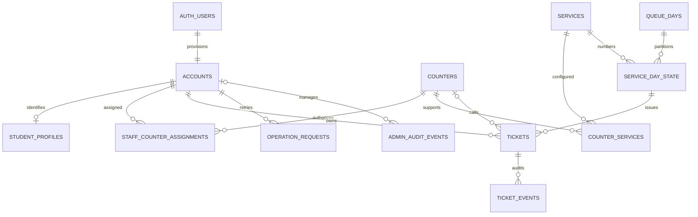

# Database engineering report

This document records the initial generation stage. For the subsequent executed
local concurrency results, see [CONCURRENCY_VALIDATION_REPORT.md](CONCURRENCY_VALIDATION_REPORT.md).
Its original "not applied/not executed" statements are historical, not the current
validation status.

Date: October 16, 2026. Status: locally generated proposal; not applied.

## Outcome and verification boundary

Four ordered Supabase migrations, local configuration, transactional pgTAP tests,
multi-connection concurrency tests, and offline structural checks are provided.
No live database connection, SQL execution, deployment, reset, deletion of a
database, commit, or push was performed. No `.env` values were read.

Supabase CLI, Docker, and psql were not available on PATH during preparation.
Consequently PostgreSQL compilation, migration execution, pgTAP, Realtime, and
multi-session integration tests have NOT been validated in a running database.
Static checks are not a substitute for those checks. Production readiness remains
conditional on local/staging validation and approval.

Executed verification: six offline structural tests passed; Python concurrency
runner syntax passed. PostgreSQL and integration tests are prepared but unexecuted.

## Files and ordering

| File | Contents |
| --- | --- |
| `migrations/20261016000100_queue_tables.sql` | Three schemas, two enums, 15 tables, keys, checks, indexes, RLS and read policies |
| `migrations/20261016000200_queue_operations.sql` | Account provisioning, mutex, idempotency, display projection, issuance, call/finish, owner reads |
| `migrations/20261016000300_queue_administration.sql` | Operator-only bootstrap, day operations, account/counter/service administration, scoped staff reads |
| `migrations/20261016000400_queue_seed_security.sql` | Five services, five closed counters, final function grants, sanitized Realtime publication |
| `config.toml` | Local PostgreSQL 17 configuration; `queue_api` and `queue_display` exposed, `queue_private` excluded |
| `tests/database/queue_test.sql` | Rollback-only pgTAP behavior and permission tests |
| `tests/concurrency.py` | Separate psql sessions for retry, quota, numbering, competing calls, and closure tests |
| `tests/static_check.py` | Offline ordering, grant coverage, schema exposure, function-header and Python syntax checks |

Initial operational seed data is in the versioned fourth migration rather than
`seed.sql`, so approved production application receives the same reference data.
Counter service assignments and staff assignments start empty. Counters and days
start closed. Assignments were not specified and are not invented.

## Changes from the earlier proposal

- Served count replaces the ambiguous qualifying-ticket count. A skip never
  consumes quota unless the ticket later becomes served.
- Quota date is the ticket's queue-day date, not completion date.
- Number allocation is daily per service; waiting positions are global to the
  location. This allows a skipped prior-day ticket to join the actual tail.
- Day closure atomically forfeits all its waiting/called tickets and releases counters.
- Only assigned CASHIER accounts perform cashier actions. ADMIN does not implicitly
  inherit cashier powers; that behavior was not approved.
- No parent/payor model or Google OAuth configuration is introduced.
- Student profiles remain optional and private; their verification workflow is
  explicitly unresolved. Authentication is not proof of enrollment.

## ERD

The singleton settings row controls timezone and global waiting-position allocation.
Display tables deliberately have no user relationships. They are derived,
transactionally maintained data rather than additional sources of business truth.

## Data dictionary

All private tables are under `queue_private`; display tables are under `queue_display`.
UUID PKs use `gen_random_uuid()` except account IDs, which reference Supabase Auth.
Timestamps are `timestamptz`; local business dates are `date`.

| Table | Keys and main fields | Purpose |
| --- | --- | --- |
| settings | singleton boolean PK; timezone; last_wait_position bigint | Asia/Manila and global mutation lock/tail allocator |
| accounts | Auth UUID PK/FK; role enum; enabled; created_at; updated_at | Server-controlled roles, immediate application revocation |
| student_profiles | account_id PK/FK; unique student_number; display_name; verified_at; created_at | Private identity, reserved for future verified enrollment workflow |
| services | UUID PK; unique fixed code; name; enabled; updated_at | TP, SOA, PNEP, REF, ADJ |
| counters | UUID PK; unique number 1–5; label; is_open; updated_at | Physical counter configuration |
| counter_services | composite counter/service PK and FKs | Configurable service eligibility |
| staff_counter_assignments | composite account/counter PK and FKs | Explicit cashier authorization |
| queue_days | UUID PK; unique business_date; timezone_snapshot; opened_at; closed_at/by | Formal queue-day lifecycle |
| service_day_state | day/service composite PK/FKs; last_number bigint | Transactional daily ticket allocator |
| tickets | UUID PK; owner; day/service FK; number; global wait_position; status; nullable counter; timestamps | Operational state |
| ticket_events | UUID PK; ticket/actor/counter FKs; event; from/to state; occurred_at | Append-only client-inaccessible history |
| operation_requests | actor/request UUID composite PK; operation; parameters/result jsonb; created_at | Exact request replay |
| admin_audit_events | UUID PK; actor; action; parameters including approved previous values; occurred_at | Role, configuration, closure and bootstrap audit |
| counter_state | independent counter UUID PK; label; open; current ticket/service/date; updated_at | Public current counter projection |
| service_state | service/date composite PK; waiting_count; updated_at | Public totals for open days |

Displayed labels pad numbers to at least three digits; TP-1000 remains TP-1000.
Date plus service plus sequence identifies a daily number. The UUID identifies
the record across all days. A public counter UUID has no account linkage.

## Exact lifecycle

| From | To | Operation | Authorized actor |
| --- | --- | --- | --- |
| none | WAITING | issue_ticket | Enabled non-anonymous STUDENT |
| WAITING | CALLED | call_next | Enabled CASHIER assigned to the selected open counter |
| CALLED | WAITING | finish_ticket with SKIP | Enabled CASHIER assigned to the current counter |
| CALLED | SERVED | finish_ticket with SERVE | Enabled CASHIER assigned to the current counter |
| WAITING or CALLED | FORFEITED | manage_day with CLOSE | Enabled ADMIN |

Terminal tickets cannot transition again. There is no cancellation, individual
forfeiture, recall-in-place, reopening, or correction RPC. Those policies have not
been approved. Skip clears the current counter and preserves the ticket number;
events retain historical counter assignment after service or forfeiture.

## Integrity and concurrency

Every mutation first locks the singleton settings row using `FOR UPDATE`.
Authorization is checked after acquiring it. Role changes, assignment changes,
day closure, issuance, calls and service completion therefore share one serial
order. No operational RPC acquires another lock first. Reads remain concurrent.
This intentionally conservative design is appropriate to the initial five-counter
scope, but should be load-tested; a long caller transaction can delay all mutations.
Clients should use separate RPC transactions rather than wrapping multiple RPCs
in long-lived server transactions. No external network calls occur under locks.

Additional database safeguards:

- Unique active owner across WAITING/CALLED, across every service and date.
- Unique called counter; composite FK enforces counter/service eligibility.
- Unique day/service/sequence and unique global waiting position.
- Positive numbers; status/timestamp/counter consistency checks.
- Explicit FK deletion restrictions; no application delete operations.
- Account, quota, waiting selection, assignment and event indexes.
- Assignment changes and counter reconfiguration reject busy counters.
- Role changes/disable reject unresolved owned active tickets or called cashier work.
- The last enabled administrator cannot be disabled or demoted.
- Disabling a service requires resolving its active tickets.

Direct database owners remain trusted. Multirow quota and state authorization are
function invariants, not CHECK constraints. Browser roles cannot write operational
tables. A future trusted import tool must obey the same lock and invariants.

### Quota and midnight

Issuance checks the number of SERVED rows for owner + service + issuance queue day.
Service completion repeats this check while holding the same mutation lock.
Only SERVED rows count; skip events and FORFEITED rows do not.

The one-active-ticket constraint means a user cannot reserve several potential
served tickets. Two simultaneous completion requests either replay the same
idempotent result or the second rejects the now-terminal ticket. A user with two
served tickets cannot issue a third for that service/day.

After acquiring the lock, issuance captures `clock_timestamp()` and converts it
to Asia/Manila. A request waiting across midnight uses the new date, not stale
transaction-start time. Its issuance day never changes afterward.

An unfinished prior-day ticket remains active until served or its day is formally
closed. It blocks new issuance. Serving it after midnight charges its original day.
Calls select the lowest global waiting position across open days for the chosen
service. A skip moves behind all existing waiting tickets, including newer days.
Closing an old day affects only tickets issued on that day. It cannot race a serve:
whichever mutation obtains the lock first determines the valid result.

### Idempotency

All mutations require a request UUID. Actor + UUID is unique across operations.
Exact retries return the original response; changed parameters/operation reject.
Authorization is still checked before replay. Results describe the original
operation and may not represent current ticket state; clients should refresh.
An empty call-next result is also cached: use a new key for a new polling attempt.
No retention purge is implemented because deleting replay records changes retry guarantees.

## RLS, function ownership and schema exposure

Private tables have RLS enabled and deliberately no browser policies or grants:
default deny. They are not exposed through PostgREST. Private reads use owner-scoped
RPCs checking `auth.uid()`, and staff reads return ticket data without student PII.
Public display tables have SELECT-only policies for anon/authenticated; no writes.

API functions are SECURITY DEFINER with empty search_path and qualified names.
Only authenticated gets EXECUTE on the enumerated API functions. Internal helpers
and bootstrap have EXECUTE revoked from PUBLIC/anon/authenticated/service_role.
The migration owner is trusted and bypasses RLS inside definers. This is explicit:
the private isolation boundary is grants plus reviewed function checks, not an
assumption that RLS constrains postgres-owned functions. A dedicated least-privilege
function owner can be introduced later with staging validation of Supabase ownership rules.

Role metadata from OAuth or user-editable Auth metadata is ignored. New Auth users
receive STUDENT only; existing Auth IDs are backfilled with the same safe role.
Anonymous Auth accounts cannot mutate queues. Google OAuth settings are untouched.

Local config exposes queue_api and queue_display only alongside public. Hosted API
settings must later add these two schemas explicitly and must exclude queue_private.
The migration does not modify hosted API configuration. Frontend RPCs should use
`supabase.schema('queue_api').rpc(...)`. Display subscriptions target queue_display.

The sanitized tables are added to supabase_realtime only when that publication
exists. Private tables are not added. Owner/staff live views should refetch their
authorized RPC data after sanitized updates; no private-table subscription is
promised by this implementation. Reconnects require a new snapshot. Closed-day
aggregate rows are deleted; consumers should refetch on change events rather than
depend on DELETE payload contents.

## Administrator bootstrap procedure

1. After approved migration application, create the intended administrator using
   normal Supabase Auth and verify the account's identity out of band.
2. In a trusted operator SQL session, verify its exact UUID, confirmed email, and
   non-anonymous status. Do not choose an account solely from user-controlled metadata.
3. The database operator invokes `queue_private.bootstrap_admin` with that UUID.
   No UUID or administrator identity is seeded into migration files.
4. Verify the BOOTSTRAP audit event and intended role. The function rejects a second
   bootstrap, even if all administrator roles were later removed by a trusted operator.
5. Further changes use the administrator RPC. Protect admin authentication with
   MFA before production; mandatory AAL2 enforcement is a remaining product decision.

There is no public first-user-wins endpoint and no service-role key in the browser.
Disaster recovery is a documented trusted-operator responsibility, not a bypass RPC.

## Automated tests and safe execution

The pgTAP suite covers numbering, active-ticket restriction, service-specific served
limits, skipped-then-served accounting, queue tail order, role escalation denial,
counter authorization, owner history isolation, closure, last-admin protection,
one-time bootstrap, midnight ownership/quota, RLS coverage, function privileges,
search paths, and actual authenticated-role private access denial.

The Python integration suite uses multiple psql processes to test retry replay,
concurrent calls, concurrent numbering, served limits, and closure/call races.
It rejects non-loopback hosts and ports other than 54322 before connecting. It
creates committed uniquely named test users and tickets and never deletes them.
Run it once in a fresh disposable instance; it intentionally leaves its queue day
closed and fixtures present. pgTAP rolls all fixtures back.

Safe procedure, to be performed only when local SQL execution is desired:

1. Install Docker, Supabase CLI and psql. Copy this supabase folder into an isolated
   disposable workspace with no linked hosted project and no production credentials.
2. Run `supabase start`. On a new instance its initial setup applies local migrations.
   If already initialized, review `supabase migration up --local` before running it.
   Do not use db reset, db push, project linking, or a hosted connection string.
3. Run `supabase db lint --local`, then `supabase test db` before manual bootstrap
   or operational use. Confirm every test passes and inspect RLS/grants locally.
4. Set QUEUE_TEST_DATABASE_URL to the local database URL provided by local tooling;
   keep it out of source control and shell logs. Run `python supabase/tests/concurrency.py`.
5. Verify Data API schema access and Realtime with local anon/authenticated clients:
   private schemas must be inaccessible, owner reads isolated, and display payloads
   free of student identity. Publication membership alone is not an end-to-end test.
6. Repeat in an approved staging environment, inspect the target's preexisting
   schemas, Auth triggers, grants and publication, and review backups before
   requesting separate production approval. Existing-object collisions intentionally
   fail rather than overwrite unknown objects.

Offline checks: `python supabase/tests/static_check.py`. These checks do not connect
to a database or prove PL/pgSQL runtime correctness.

## Remaining issues and explicit provisional choices

- Opening is an explicit ADMIN operation for the current local date only; closing
  is irreversible through the API. Confirm the operational opening workflow.
- Any authenticated non-anonymous STUDENT account can issue tickets; enrollment
  verification and signup admission are not yet enforced. Resolve before production
  if only enrolled students may participate. Profiles currently have no mutation RPC.
- Multiple cashiers can be assigned to one counter, and one cashier to several.
  Any assigned cashier may finish that counter's called ticket. Confirm shift/ownership rules.
- ADMIN cannot perform cashier actions with the single-role model. Confirm whether
  explicit administrator operational authority is required.
- Ticket issuance is restricted to STUDENT. Confirm whether CASHIER/ADMIN accounts
  also need to obtain personal tickets; the one-active-ticket index already applies
  to every owner regardless of role, but staff issuance is currently denied.
- Manual category selection is implemented; cross-service fairness/priority is deferred.
- No automatic expiry, skip limit, individual abandonment, student cancellation,
  per-user issuance rate limit, retention purge, or estimated wait calculation is invented.
  Unlimited issuance through repeated terminal forfeitures needs an approved abuse policy.
- An admin who closes a day forfeits all unfinished tickets immediately. Confirm
  whether the UI requires a review step; no separate close-preview RPC is included.
- Public read access and counters' service/date/number visibility are enabled.
  Confirm anonymous display access and privacy retention expectations.
- Student/staff private updates use refetching, not private Realtime subscriptions.
  Define notification latency expectations before frontend integration.
- No runtime database tools were available; execution and end-to-end Supabase
  compatibility remain unverified, not claimed as passing.
- Existing live schemas and Auth policies are unknown. New names avoid common
  collisions but target review is mandatory before application.

Approval is required before any migration is applied to Supabase.
